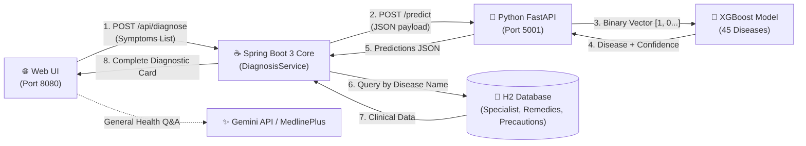

# 🏥 MediAI — AI Disease Prediction & Healthcare Assistant

MediAI is a full-stack healthcare assistant application built with **Spring Boot 3 (Java 17)** and a **Python FastAPI / XGBoost** machine learning microservice.

It predicts diseases based on patient symptoms using a trained **XGBoost Classifier** and enriches the results with verified clinical advice (specialist to consult, severity level, home remedies, and precautions) from an **H2 relational database**. It also provides general health Q&A powered by **Google Gemini**.

---

## 🏗️ System Architecture



---

## ⚙️ How It Works (End-to-End Flow)

1. **Symptom Input:**  
   The user selects or types symptoms (e.g., *fever, headache, chills*) in the web interface.
2. **Spring Boot Orchestration:**  
   The request is received by `DiagnosisController` and passed to `DiagnosisService`. Spring Boot uses modern `RestClient` to call the Python microservice at `http://127.0.0.1:5001/predict`.
3. **Feature Encoding (Vectorization):**  
   The Python service maps the symptoms against a canonical list of 30 known symptoms (`features.json`) to create a 30-element binary vector:
   $$\text{Input Vector} = [1.0, 0.0, 0.0, 1.0, \dots, 0.0]$$
   *(1.0 means symptom is present, 0.0 means absent).*
4. **XGBoost Inference:**  
   The pre-trained `disease_predictor.pkl` runs gradient boosted decision tree inference (`predict_proba`) and computes probability scores across 45 diseases.
5. **Database Clinical Enrichment:**  
   The Python service returns the top predicted disease and confidence percentage to Spring Boot. Spring Boot then queries the in-memory **H2 database** via **Spring Data JPA** (`diseaseRepository.findByDiseaseNameIgnoreCase(...)`) to retrieve:
   - **Recommended Medical Specialist** (e.g., *Infectious Disease Specialist*, *Pulmonologist*)
   - **Severity Level** (*Low*, *Moderate*, *High*, *Emergency*)
   - **Safe Home Remedies** (hydration, rest guidelines)
   - **Precautions & Warnings**
6. **Result Display:**  
   The frontend renders a clean diagnostic card with confidence progress bars and clinical recommendations.

---

## 🛠️ Tech Stack

| Layer | Technologies | Role |
| :--- | :--- | :--- |
| **Backend Core** | Java 17, Spring Boot 3.2.4, Spring Data JPA, Maven | Orchestration, business logic, REST APIs, database queries |
| **Database** | H2 In-Memory Database (`jdbc:h2:mem:medibotdb`) | Stores 44+ pre-seeded disease clinical profiles |
| **ML Microservice** | Python 3, FastAPI, Uvicorn, XGBoost, Scikit-learn, NumPy | Model inference, symptom vectorization, probability scoring |
| **GenAI Chat** | Google Gemini API (`gemini-3.1-flash-lite`), MedlinePlus XML | Evidence-grounded conversational medical Q&A |
| **Frontend** | Vanilla HTML5, CSS3, ES6 JavaScript | Clean clinical dashboard, dynamic symptom tagging, real-time typing |

---

## 📁 Project Structure

```
Ai-medi-bot-main/
├── spring-boot-backend/              # Java 17 + Spring Boot 3 Backend
│   ├── src/main/java/com/medibot/
│   │   ├── config/DataInitializer.java  # Seeds 44+ disease records into H2 DB on startup
│   │   ├── controller/               # REST Endpoints (DiagnosisController, ChatController)
│   │   ├── dto/                      # Request & Response Data Transfer Objects
│   │   ├── model/DiseaseInfo.java    # JPA Database Entity
│   │   ├── repository/               # Spring Data JPA Repository
│   │   └── service/                  # Business Logic (DiagnosisService, MlClientService, Gemini)
│   └── src/main/resources/
│       ├── application.properties    # Server & H2 Database configuration
│       └── static/                   # Web UI (index.html, style.css, script.js)
│
├── ml-service/                       # Python ML Microservice (Port 5001)
│   ├── ml_service.py                 # FastAPI server exposing /predict and /features
│   ├── disease_predictor.pkl         # Trained XGBoost model & LabelEncoder
│   ├── features.json                 # Canonical list of 30 symptom features
│   ├── realistic_infectious_disease_dataset_45.csv  # Training dataset
│   ├── train_test_final.py           # Model training script
│   └── requirements.txt              # Python dependencies
│
├── run_all.bat                       # 1-Click launcher for both services
└── README.md
```

---

## 🚀 Getting Started

### Prerequisites
- **Java 17+** (JDK 17 or higher)
- **Python 3.10+** (with `pip`)
- *(Optional)* **Google Gemini API Key** (for health chat mode)

---

### Step 1: Install Python Dependencies
```bash
cd ml-service
pip install -r requirements.txt
cd ..
```

### Step 2: Configure API Key (Optional)
If using the Gemini Health Q&A feature, set your API key in an environment variable or `.env` file:
```bash
set GEMINI_API_KEY=your_gemini_api_key_here
```

---

### Step 3: Run the Application

#### Option A: One-Click Startup (Windows)
Double-click [`run_all.bat`](run_all.bat) or run in terminal:
```cmd
run_all.bat
```

#### Option B: Manual Startup

**Terminal 1 — Python ML Service (Port 5001):**
```bash
cd ml-service
python ml_service.py
```
*Health Check:* [http://127.0.0.1:5001/health](http://127.0.0.1:5001/health)

**Terminal 2 — Spring Boot Backend (Port 8080):**
```bash
cd spring-boot-backend
mvnw.cmd spring-boot:run
```

Once started, open your browser and navigate to:  
👉 **[http://localhost:8080](http://localhost:8080)**

---

## 🌐 API Endpoints

| Method | Endpoint | Description |
| :--- | :--- | :--- |
| `POST` | `/api/diagnose` | Primary disease prediction endpoint (XGBoost + H2 clinical lookup) |
| `GET` | `/api/features` | Returns the 30 supported medical symptom features |
| `POST` | `/api/chat` | Conversational medical Q&A via Gemini API & MedlinePlus |
| `GET` | `http://localhost:5001/health` | Python ML microservice health check |
| `GET` | `http://localhost:8080/h2-console` | In-memory H2 database browser (`jdbc:h2:mem:medibotdb`) |

### Example Request (`POST /api/diagnose`)
```json
{
  "symptoms": ["fever", "joint_pain", "rash"]
}
```

### Example Response
```json
{
  "predictedDisease": "Dengue",
  "confidence": 88.45,
  "specialistToConsult": "Infectious Disease Specialist",
  "severityLevel": "High",
  "homeRemedies": "Drink plenty of fluids (water, ORS, tender coconut water) to maintain hydration.",
  "precautions": "Monitor platelet count daily, avoid aspirin or ibuprofen, rest strictly.",
  "allPredictions": [
    { "disease": "Dengue", "confidence": 88.45 },
    { "disease": "Chikungunya", "confidence": 7.21 },
    { "disease": "Malaria", "confidence": 2.15 }
  ]
}
```

---

## 💡 Interview Summary (30-Second Elevator Pitch)

> *"MediAI is a polyglot healthcare application combining a Java 17 / Spring Boot 3 enterprise backend with a Python FastAPI machine learning microservice.*
>
> *When a user inputs symptoms, Spring Boot calls our Python microservice via HTTP. The microservice converts the symptoms into a binary feature vector and runs inference using a trained XGBoost model across 45 infectious diseases. Once the predicted disease is returned, Spring Boot uses Spring Data JPA to fetch recommended medical specialists, severity levels, and home remedies from an in-memory H2 database, returning a complete, actionable diagnostic card to the user."*

---

## ⚠️ Disclaimer

MediAI is an educational decision-support project and is **not** a substitute for professional medical advice, diagnosis, or treatment. Always consult a qualified physician for medical concerns.
